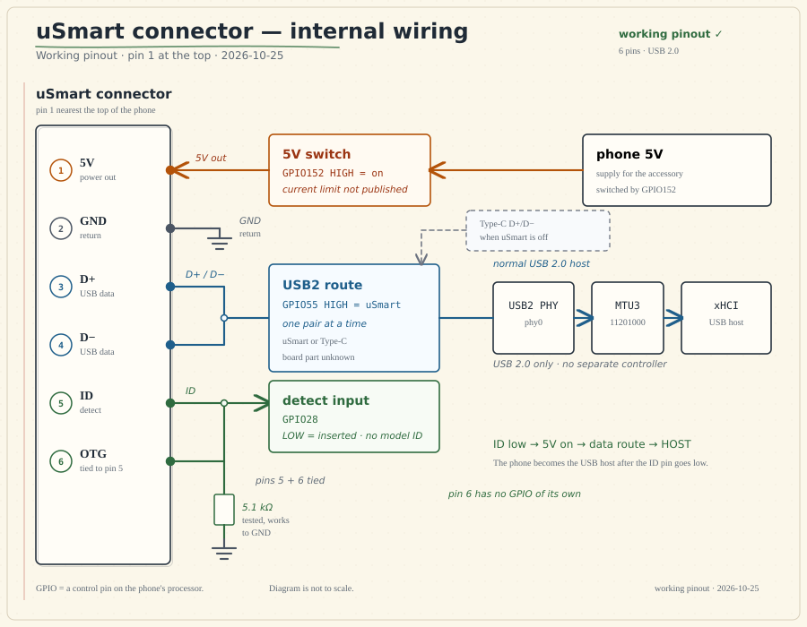

# uSmart (USmart)

uSmart is the six-pin port on the side of the Ulefone Armor 29 Pro Thermal. It's a
USB 2.0 host port with 5V power and a detect pin. The phone is the host; the accessory is
the USB device.

There's no special uSmart protocol and no authentication chip. Plug in a regular USB 2.0
device, keep its power draw sensible, and the phone should be able to talk to it. Ulefone
calls the newer version “uSmart 2.0”, but that's just a marketing name. The connection is
still USB 2.0.

## The short version

| Item | Answer |
|---|---|
| Pins | 6 |
| Data | USB 2.0 |
| Power | 5V from the phone; current limit not published |
| Phone role | USB host |
| Accessory role | USB device |
| Special protocol | None found |
| Accessory ID | Detect only; the phone does not identify the model |
| USB-C? | No. The Type-C port is separate |
| Charges the phone? | No. It is an output, not a charging input |

## The six pins

Pin 1 is nearest the top of the phone. This is the pinout people are using. The 5.1 kΩ
link on pins 5 and 6 has been tested and works.

| Pin | Name | What it does |
|---:|---|---|
| 1 | **5V** | Power for the accessory. It switches on when the phone detects a device. |
| 2 | **GND** | Ground. |
| 3 | **D+** | USB 2.0 data. |
| 4 | **D−** | USB 2.0 data. |
| 5 | **ID / detect** | Pulls low when an accessory is plugged in. |
| 6 | **ID / OTG** | Tie this to pin 5 and pull both to ground through a 5.1 kΩ resistor. |

The phone only looks at one detect input. It doesn't read a model number from the ID
pins. Pin 6 is a strap, not another data line.

### How the pins connect inside the phone

GPIO is just a control pin on the processor. This is what each connector pin connects to:

<figure class="usmart-map" style="margin:1.5rem 0;">
  
  <figcaption>How the six connector pins connect to the phone. GPIO152 and GPIO55 are internal controls, not connector pins. Pin 6 has no GPIO of its own.</figcaption>
</figure>

The three controls are simple:

- **GPIO152** turns the 5V pin on and off.
- **GPIO55** selects the uSmart USB pair instead of the Type-C pair.
- **GPIO28** watches the ID pin and tells the phone when something is plugged in.

## What happens when you plug it in

1. The accessory pulls the ID pin low through the 5.1 kΩ resistor.
2. GPIO28 sees the low level and tells the phone an accessory is present.
3. The phone switches on 5V with GPIO152.
4. The phone connects its USB 2.0 pair to uSmart with GPIO55.
5. The phone becomes the host and looks for a USB device.

Unplugging reverses the order: 5V goes off, the data pair goes back to Type-C, and the
phone drops the host role.

The phone doesn't ask what the accessory is before it powers the port. It just sees the
ID pin go low. That's why the wiring has to be right before you plug anything in.

## Power

Pin 1 gives you 5V from the phone. The current limit isn't published, so treat uSmart as
a small auxiliary supply, not a power bank.

- Start with a low-power device.
- Measure the current before connecting a motor, radio, lamp or anything else hungry.
- Don't feed 5V into pin 1.
- Don't assume it can supply 500 mA, 1.8 A or any other number.
- The Type-C charger ratings don't apply to uSmart.
- There's no evidence that uSmart can charge the phone or reverse-charge another device.

Ulefone says Type-C charging can continue while a uSmart accessory is attached. That's
plausible because the power paths are separate, but there's no test here that runs
Type-C data and uSmart data at the same time.

## What you can connect

The phone is the host. The accessory must be a USB device, not another host.

| Device type | What to expect |
|---|---|
| UVC camera or endoscope | Best supported. The stock app includes a generic UVC path. |
| USB audio | A standard device may work. The H01 headset is not proven on this phone. |
| Keyboard or mouse | A standard HID device may work. There is no built-in uSmart UI for it. |
| USB serial adapter | May work if Android has a driver or the app provides one. |
| USB storage | May work, but the stock app's storage path is not fully mapped. |
| USB 3.0, DisplayPort or HDMI | Not supported through uSmart. |
| Analog audio | No analog audio path was found. |
| High-power accessories | Wait until the 5V current limit is measured. |

A USB hub is untested. It also adds another device and more power draw, so keep the setup
simple.

## Official uSmart accessories

These are Ulefone products, not independent test results:

| Accessory | What it is | Status on this phone |
|---|---|---|
| uSmart E01 | Endoscope | Listed for Armor 29 |
| uSmart E02 | Dual-camera endoscope | Listed for Armor 29 |
| uSmart E03 | Articulating endoscope | Listed for Armor 29 |
| uSmart C01 | Microscope | Listed for Armor 29 |
| uSmart H01 | Earphone, microphone and PTT | Not listed for Armor 29; compatibility unconfirmed |

“Listed” means Ulefone says it works. It does not mean every feature has been tested on
this exact phone.

## uSmart and USB-C

They're separate ports with different jobs.

| | uSmart | USB-C |
|---|---|---|
| Pins | 6 | 24 |
| Data | USB 2.0 | USB 2.0, USB 3.x, DisplayPort and other modes |
| Power | 5V out to an accessory | Charging, USB-PD and source/sink roles |
| Reversible | No | Yes |
| Same time as the other port? | Charging is claimed; simultaneous data is not proven | — |

uSmart doesn't use USB-C CC, SBU or USB-PD signalling. Don't treat it like a USB-C
receptacle.

## Making your own accessory

Start with a normal USB 2.0 device. The phone is the host, so don't try to connect another
host.

1. Connect **5V**, **GND**, **D+** and **D−**.
2. Tie pins **5 and 6** to ground through a **5.1 kΩ** resistor.
3. Keep the 5V current low until the limit is measured.
4. Add ESD protection and inrush limiting.
5. Do not backfeed power into the phone.
6. If the accessory has its own power supply, leave pin 1 disconnected.

Don't connect a charger to the 5V pin. It's an output from the phone, not a charging
input. A UVC camera or a USB serial adapter is a safer first project than a motor or a
radio.

## What's known, and what isn't

| Solid | Not documented |
|---|---|
| Six pins: 5V, GND, D+, D−, ID and OTG | Maximum current on the 5V pin |
| The 5.1 kΩ detect connection works | Official Ulefone pinout drawing |
| The phone switches 5V on when ID goes low | Exact role of each of the two ID pins |
| The phone switches its USB 2.0 pair to uSmart | USB descriptors of the official accessories |
| The phone becomes a USB host | Simultaneous Type-C data and uSmart data |
| No model ID or authentication | Connector part number and mating plug |
| UVC cameras are the best-supported accessory | — |

The pin order is a working pinout, not a stock-firmware finding. It's the order that has
been tested with the 5.1 kΩ resistor.

## For kernel people

The three controls are:

| Control | Job |
|---|---|
| Detect input (`GPIO28`) | Reads the ID pin |
| Power switch (`GPIO152`) | Turns the 5V pin on and off |
| Data switch (`GPIO55`) | Connects the USB 2.0 pair to uSmart or Type-C |

Everything after the switch is the phone's normal Linux USB host stack. There is no
separate uSmart controller.

`uvc_insert_status = 1` only means the ID pin is low. It does not mean a camera is
streaming or that the phone has recognized a USB device.

## Where this comes from

This page is a simpler version of the LieppOS uSmart research. The full evidence is in
the research repository.

- [uSmart research snapshot](https://github.com/LieppOS/LieppOS-ulefone-gq5012bf1-research/tree/473a2ef590d9af6b55b21177d491543dbf1261f8)
- [Hardware contract](https://github.com/LieppOS/LieppOS-ulefone-gq5012bf1-research/blob/473a2ef590d9af6b55b21177d491543dbf1261f8/kernel/usmart/hardware-contract.md)
- [Power path](https://github.com/LieppOS/LieppOS-ulefone-gq5012bf1-research/blob/473a2ef590d9af6b55b21177d491543dbf1261f8/kernel/usmart/power-path.md)
- [USB routing](https://github.com/LieppOS/LieppOS-ulefone-gq5012bf1-research/blob/473a2ef590d9af6b55b21177d491543dbf1261f8/kernel/usmart/usb-routing.md)
- [Accessory support](https://github.com/LieppOS/LieppOS-ulefone-gq5012bf1-research/blob/473a2ef590d9af6b55b21177d491543dbf1261f8/kernel/usmart/accessory-enumeration.md)
- [Community uSmart adapter pinout](https://makerworld.com/en/models/233363-ulefone-usmart-usb-c-adaptor)
- [Ulefone 19T uSmart notes](https://github.com/timonoko/Ulefone-Usmart-connector)
- [Ulefone Armor 29 Pro Thermal](https://www.ulefone.com/products/armor-29-pro-thermal-version)
- [Ulefone uSmart H01](https://www.ulefone.com/products/usmart-h01)

Last updated: 2026-10-25.
